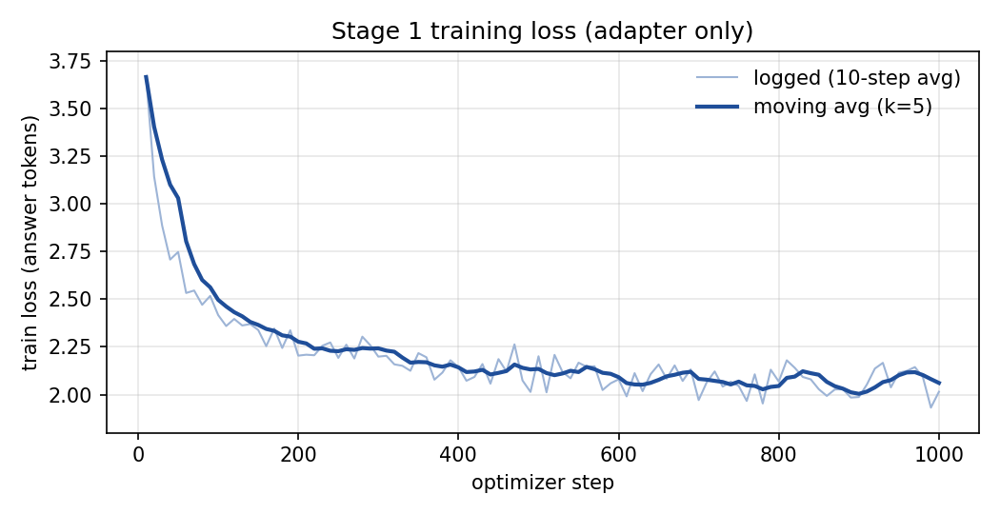

# qwen-vl

> A from-scratch, single-GPU re-implementation of the Qwen-VL recipe: SigLIP 2 + DINOv2 vision encoders, a cross-attention resampler, and a Qwen2.5 language model.
> 

**Unofficial.** This is an independent implementation of the method described in the
[Qwen-VL paper](https://arxiv.org/abs/2308.12966). It is not affiliated with, endorsed by, or derived from
the official [QwenLM/Qwen-VL](https://github.com/QwenLM/Qwen-VL) repository or its weights.

**Contents:** [Overview](#overview) · [How it works](#how-it-works) · [Design decisions](#design-decisions) ·
[Results](#results) · [Installation](#installation) · [Usage](#usage) · [Repository layout](#repository-layout) ·
[Limitations and roadmap](#limitations-and-roadmap) · [Acknowledgements](#acknowledgements-and-licenses)

---

## Overview

### Objective

The goal of this project is to **understand and reproduce, end to end, how a Qwen-VL-style
vision-language model is built**, not to beat benchmarks. Concretely:

1. Implement the Qwen-VL recipe (vision encoder → resampler → LLM, three-stage training, and a text interface
   that supports grounding) in small, readable code.
2. Replace the paper's components with current open models: SigLIP 2, DINOv2 and Qwen2.5.
3. Make the whole pipeline runnable and reproducible on **one consumer GPU** (developed and trained on a laptop RTX 3050).
4. Evaluate honestly, with controls that show whether the model is actually *using* the image.

### Why build it

Reading a paper doesn't show where the details are: how visual tokens are spliced into the LLM input,
which tokens receive loss, how a frozen LLM can be aligned through a small adapter, why box coordinates
survive resizing. Large VLM codebases hide these details behind abstractions. This one is about 830 lines
of library code (of which the model itself is about 220), small enough to read in an afternoon and modify.

### What it does

- **Encodes an image into 256 visual tokens.** SigLIP 2 (optionally fused with DINOv2) produces patch features,
  and a position-aware cross-attention resampler compresses them to a fixed-length sequence.
- **Feeds them to a causal LLM** between `` and `</img>` tokens, so the LLM treats the image as part of the prompt.
- **Trains in three stages** (alignment → multi-task → instruction tuning) with a single trainer, including LoRA
  and gradient checkpointing for small GPUs.
- **Speaks a grounding-ready text format** (`<ref>`, `<box>`) with helpers to write and parse boxes.
- **Evaluates captioning** with BLEU / ROUGE-L / CIDEr and a shuffled-image control.
- **Ships a data-preparation script** that builds a stage-1 dataset from COCO (about 1 GB).

**Current state:** stage 1 is trained and evaluated and captions images well (COCO CIDEr 1.20 on a 200-image
held-out set). Stages 2 and 3, and with them question answering, grounding and OCR, are implemented but not yet
trained at scale. See [Limitations and roadmap](#limitations-and-roadmap).

---

## How it works

```
image (384x384) ──► SigLIP2 ViT-SO400M/14 ─┐
                                           ├─ concat (27x27 patches, 1152+1024 channels)
image (378x378) ──► DINOv2 ViT-L/14 ───────┘  (optional)
                              │
                              ▼
        Resampler: 1 cross-attention layer, 256 learned queries,
        2D sin-cos positions added to queries and keys
                              │  256 visual tokens
                              ▼
 "" [256 visual embeddings] "</img>" prompt text ──► Qwen2.5 LLM ──► answer
```

**Visual tokens as placeholders.** Each training sample contains 256 `<imgpad>` placeholder tokens between
`` and `</img>`. At forward time their embeddings are *replaced* with the resampler output, so the LLM
sees an ordinary embedding sequence and no change to the LLM architecture is needed.

**Text interface.** Following Qwen-VL, `<ref>…</ref>` names a region and `<box>(x1,y1),(x2,y2)</box>` gives
coordinates normalised to `[0, 1000)`. Boxes are plain text, so grounding needs no new output head.

**Loss.** Cross-entropy only on answer tokens (and EOS). Image tokens and prompts are masked with `-100`.

**Three stages** (following the paper's Table 8, scaled down):

| Stage | Trains | Purpose | Peak LR |
|---|---|---|---|
| 1. Alignment | adapter (`--train_vit` adds the ViTs) | teach the adapter to map visual features into the LLM's embedding space | 2e-4 |
| 2. Multi-task | everything (or LoRA) | captioning, VQA, grounding and OCR together, at the same time | 5e-5 |
| 3. Instruction tuning | LLM + adapter | conversational and instruction following | 1e-5 |

---

## Design decisions

Each choice below has a reason; where a choice is untested, it says so.

| Decision | Choice | Rationale |
|---|---|---|
| Adapter | Cross-attention **resampler**, 256 queries (not an MLP projector) | Output length is fixed at 256 regardless of encoder resolution, so LLM cost stays constant. Position embeddings on queries and keys preserve *where* things are, which grounding depends on. Faithful to the paper. |
| Main encoder | **SigLIP 2** SO400M/14 at 384px | Language-aligned encoders give semantically meaningful features that an LLM can read; the paper argues for this. SigLIP 2 is a strong current open option. |
| Second encoder | **DINOv2** ViT-L/14, fused channel-wise | Self-supervised features are strong on spatial structure, which complements SigLIP for localisation. DINOv2 is *not* language-aligned, so it supplements SigLIP rather than replacing it. Both use patch size 14, so feeding DINOv2 at 378px gives the same 27×27 grid as SigLIP at 384px, and features concatenate with no resampling. **Not yet ablated** (see [roadmap](#limitations-and-roadmap)). |
| LLM | **Qwen2.5-1.5B** | Same family as the paper's LLM, and small enough for a laptop GPU. The code works with other sizes by changing one argument. |
| Stage 1 | **Adapter only; ViTs and LLM frozen** | Cheaper and more stable for a first run. This **deviates from the paper**, which also trains the ViT in stage 1. `--train_vit` restores that. |
| Image resize | **Squash to 384×384, no crop** | Cropping would cut off objects and invalidate normalised box coordinates; squashing keeps them valid. |
| Evaluation | Metrics **plus a shuffled-image control** | Caption metrics alone can be inflated by a strong language prior (fluent, typical COCO-style text). Re-scoring with the wrong images separates "uses the image" from "writes plausible captions". |
| Training loop | Plain PyTorch, single GPU | Every step of the pipeline is visible in one file. Multi-GPU support is left out on purpose. |

**Differences from the paper**

| | Qwen-VL paper | This repo |
|---|---|---|
| Vision encoder | OpenCLIP ViT-bigG | SigLIP 2 SO400M (+ optional DINOv2) |
| LLM | Qwen-7B | Qwen2.5-1.5B (configurable) |
| Input resolution | 224 → 448 | fixed 384 |
| Stage-1 trainable | ViT + adapter | adapter only (ViT optional) |
| Stage-1 data | ~1.4B image-text pairs | 24k COCO captions |
| Hardware | large GPU cluster | one laptop GPU |

---

## Results

**What this run was designed to answer:**
(1) does the pipeline work end to end, (2) does the model genuinely use the image, and (3) how far does
adapter-only alignment with a frozen LLM get on a small dataset?
**What it was not designed to answer:** the contribution of DINOv2, or performance on VQA, grounding and OCR
(stages 2 and 3 have not been run).

**Setup.** Qwen2.5-1.5B, SigLIP 2 + DINOv2, adapter-only training. Evaluated on 200 held-out COCO val2017 images
(5 references each), greedy decoding.

| Metric | Trained model | Control: images shuffled |
|---|---|---|
| CIDEr | **1.203** | 0.047 |
| BLEU-1 | 0.731 | 0.395 |
| BLEU-4 | 0.288 | 0.026 |
| ROUGE-L | 0.535 | 0.297 |
| Unique-caption ratio | 0.965 | 0.965 |
| Avg. caption length (words) | 10.1 | 10.1 |

**Findings**

- **The pipeline works.** Splicing the resampler output into the LLM, the loss masking and the training loop
  all behave as intended: the model produces fluent, mostly correct captions.
- **The model uses the image.** With the wrong images, CIDEr falls from 1.20 to 0.05, so captions are
  conditioned on the visual tokens, not generated from a language prior. The unique-caption ratio of 0.965
  also shows it is not collapsing to a few stock phrases.
- **A frozen LLM plus a 15.5M-parameter adapter gets surprisingly far.** The loss falls from 3.67 to about 2.1 and
  plateaus from around step 400, so more stage-1 steps would add little. Further gains need the LLM to adapt
  (stage 2) or more diverse data.
- **Errors are in fine detail.** Captions get the scene right but are often generic or wrong on colours, object
  identity or fine categories (see the examples).

<p align="center"></p>

**Training setup**

| | |
|---|---|
| Trainable | adapter only (15.5M parameters); LLM, SigLIP 2 and DINOv2 frozen |
| Data | COCO val2017 captions: 4,800 images, 24,000 captions (200 images held out) |
| Schedule | 1000 steps × effective batch 16 ≈ 16k samples (≈ 0.67 epoch); peak LR 2e-4, cosine, 50 warm-up steps |
| Hardware | single laptop RTX 3050 |
| Wall-clock | ≈ 43 h (156,011 s); typical pace ≈ 2 min per optimizer step, with two stalls of about 4 h each (steps 820 and 890) |

**Example outputs** (first rows of the held-out set; all 200 are in `results/stage1_coco_eval.json`):

| Model caption | Reference caption |
|---|---|
| A skier is doing a trick in the air. | A man flying through the air while riding skis. |
| A little girl with a red umbrella in her hand. | A little girl holds up a big blue umbrella. |
| Two zebras eating grass in a field. | Two Zebras grazing together in a grassy area. |
| A fire hydrant on a street with a sign. | A red fire hydrant on a city sidewalk. |
| Two birds are swimming in a lake. | A family of swans swimming on top of a lake. |
| A cat is looking at a refrigerator in a kitchen. | A cat stands on top of a blue electric device. |

**How to read these numbers.** The held-out images are disjoint from the training images but come from the same
distribution and annotation style, the evaluation set is small (200 images), and CIDEr's IDF statistics are
computed over those 200 images only. The scores are therefore useful for comparing runs of this repository with
each other, but they are **not comparable to published benchmark numbers**, which use larger standard test
splits. This is a single run with one seed, so differences of a few hundredths between runs are within noise.

Raw files are in [`results/`](results/): evaluation output with all predictions (`stage1_coco_eval.json`), the
training log (`stage1_coco_train_log.txt`) and the loss plot.

---

## Installation

```bash
git clone https://github.com/<you>/qwen-vl && cd qwen-vl
uv sync --all-extras          # or: pip install -e ".[all]"
```

Requires Python ≥ 3.10 and an NVIDIA GPU for training and inference. Base models (Qwen2.5, SigLIP 2, DINOv2)
download automatically from the Hugging Face Hub on first use.

## Usage

### Caption an image

Download `trainable.pt` and `args.json` from the [Releases](../../releases) page into `out/stage1_coco/`, then:

```bash
qvl-infer --run_dir out/stage1_coco --image my.jpg --prompt "Generate the caption in English:"
```

### Train

**Stage 1 on COCO captions (~1 GB):**

```bash
bash scripts/stage1_coco.sh
# equivalent to:
qvl-prepare-coco --root data/coco
qvl-train --stage 1 --data data/coco/train_captions.jsonl --image_root data/coco \
          --dinov2 vit_large_patch14_dinov2.lvd142m --out out/stage1_coco \
          --bs 4 --grad_accum 4 --grad_ckpt --max_steps 1000
```

Later stages chain through checkpoints:

```bash
qvl-train --stage 2 --init_ckpt out/stage1_coco/trainable.pt --lora 64 ...
qvl-train --stage 3 --init_ckpt out/stage2/trainable.pt ...
```

Run `qvl-train --help` for all options. Training logs go to `<out>/log.jsonl`. As a guide to cost, stage 1 took
about 43 hours on a laptop RTX 3050; dropping `--dinov2` or using a smaller LLM (for example
`--llm Qwen/Qwen2.5-0.5B`) is much faster.

### Data format

JSON or JSONL; each record is either of:

```json
{"image": "a.jpg", "prompt": "Generate the caption in English:", "answer": "two dogs play in the grass"}
{"image": "a.jpg", "conversations": [{"from": "human", "value": "<image>\nWhat is this?"}, {"from": "gpt", "value": "A dog."}]}
```

Grounding targets are built with `qwenvl_siglip.data.boxes.ref_box(phrase, (x1, y1, x2, y2), w, h)`.

### Evaluate

```bash
bash scripts/eval_coco.sh out/stage1_coco
```

Reports BLEU, ROUGE-L and CIDEr on held-out COCO images, plus diagnostics. `--ablate` re-scores with shuffled
images; if scores barely drop, the model is ignoring the image.

---

## Repository layout

```
qwen-vl/
├── src/qwenvl_siglip/
│   ├── constants.py        # special tokens, image placeholder string
│   ├── modeling/           # resampler.py, vision.py (SigLIP2 + DINOv2), vlm.py (full model)
│   ├── data/               # dataset.py, transforms.py, boxes.py, coco.py
│   ├── training/           # trainer.py (stages 1-3)
│   ├── evaluation/         # metrics.py, captioning.py
│   └── cli/                # qvl-train, qvl-infer, qvl-eval-captions, qvl-prepare-coco
├── tests/                  # unit tests (no model downloads needed)
├── scripts/                # reproducible end-to-end recipes
└── results/                # evaluation outputs, training log, loss plot
```

**Development**

```bash
uv sync --all-extras && make test     # pytest
make lint                              # ruff
```

---

## Limitations and roadmap

**Limitations**

- Single-GPU training loop; no multi-GPU, DeepSpeed or layer-wise LR decay.
- Fixed 384px input (729 patches); the paper's 448px stage-2 resolution is not implemented.
- One prompt template for all stages (no ChatML); no multi-image input.
- The stage-1 model captions images but does not yet answer questions or ground objects; that needs stages 2 and 3.
- With LoRA, the new special-token embeddings stay frozen.
- Results come from one run on a small evaluation set (see [Results](#results)).

**Roadmap**

- [ ] **Ablate DINOv2:** SigLIP 2 alone vs. SigLIP 2 + DINOv2 at equal training, to test whether the fusion helps.
- [ ] **Stage 2:** multi-task training (VQA, RefCOCO grounding, OCR) with LoRA, plus VQAv2 and RefCOCO evaluation scripts.
- [ ] **Stage 3:** instruction tuning with a ChatML-style template.
- [ ] Higher resolution input and multi-GPU training.

---

## Acknowledgements and licenses

This is an independent implementation. Please cite the original work:

- **Qwen-VL**: Bai et al., [arXiv:2308.12966](https://arxiv.org/abs/2308.12966)
- **SigLIP 2**: Tschannen et al., [arXiv:2502.14786](https://arxiv.org/abs/2502.14786)
- **DINOv2**: Oquab et al., [arXiv:2304.07193](https://arxiv.org/abs/2304.07193)

Base models keep their own licenses (check Qwen2.5, SigLIP 2 and DINOv2 before redistributing weights). COCO is
not redistributed; it is downloaded from its official source under its own terms. This code is released under
the [MIT License](LICENSE).

```bibtex
@article{Qwen-VL,
  title   = {Qwen-VL: A Versatile Vision-Language Model for Understanding, Localization, Text Reading, and Beyond},
  author  = {Bai, Jinze and Bai, Shuai and Yang, Shusheng and Wang, Shijie and Tan, Sinan and Wang, Peng and Lin, Junyang and Zhou, Chang and Zhou, Jingren},
  journal = {arXiv preprint arXiv:2308.12966},
  year    = {2023}
}
```
